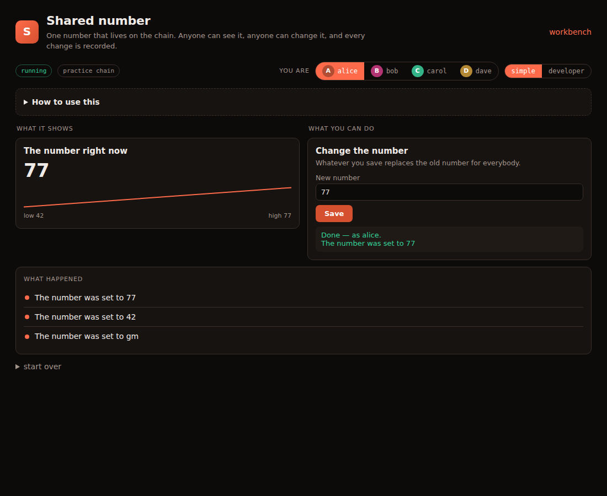
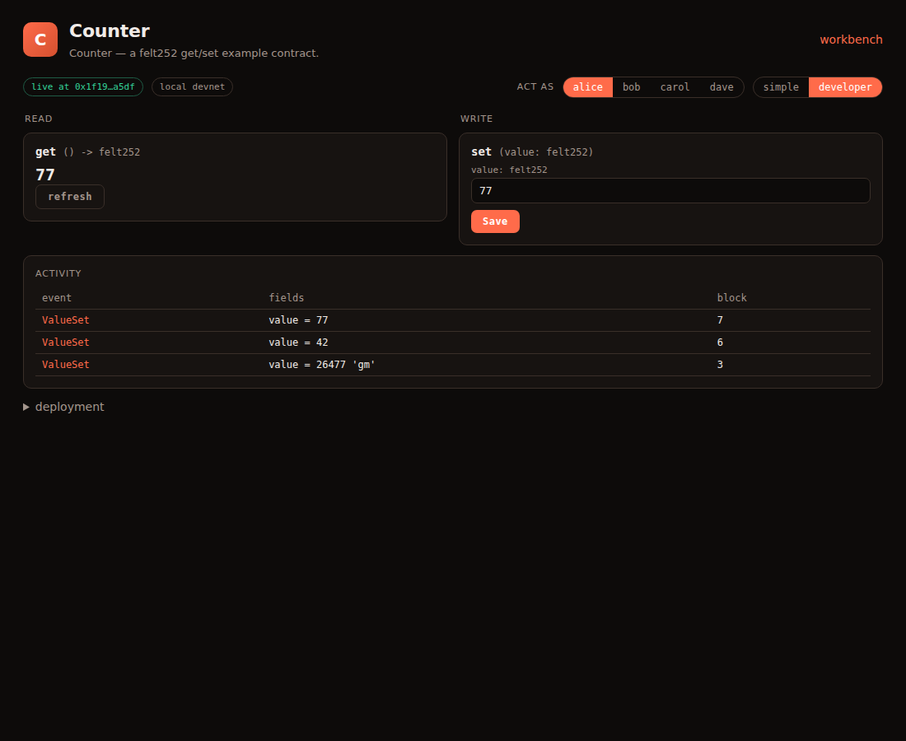

# Getting started

## What is this?

A **contract** is a small program that lives on a blockchain. Once it is
running, nobody, including whoever wrote it, can quietly change what it does
or rewrite its history. That's why people use contracts for things like
tokens, votes and prize claims.

This module is a workshop for contracts written in **Cairo**, the language of
the Starknet chain. You can:

1. **Make** a contract from a ready-made starter (a counter, a token, sealed
   answers, a claim list).
2. **Ask an AI agent** to change it in plain English ("vibecode").
3. **Test** it automatically.
4. **Use it** in a web page that is generated for you.

Nothing here touches real money. Contracts run on a **practice chain** on this
server, with four pretend people: **alice, bob, carol and dave**.

## The five-minute tour

1. Open the workbench at `/zkworld`.
2. Pick a contract on the left (try `counter`) and press **Open app**.
3. The page opens in **Simple** view:

   

   - **You are** (top right): click a person to act as them. Each one is a
     separate test wallet.
   - **What it shows** (left): what the contract knows right now. It updates
     by itself every few seconds.
   - **What you can do** (right): fill in a box and press the button. It
     goes through as the person you picked.
   - **What happened** (bottom): every change, in plain sentences.
4. Switch to bob, save a different number, and watch the chart and the
   history update.
5. Curious what's underneath? Press **developer**:

   

   Same contract, raw: function names, Cairo types (`felt252`), addresses,
   transaction hashes, block numbers. Press **simple** to go back. The page
   remembers your choice.

## Words you'll see

| word | means |
|------|-------|
| contract | the program on the chain |
| start / deploy | put a copy of the contract on the chain so it can be used |
| check / read | ask the contract something. Free, changes nothing |
| send / write | ask the contract to change something. Recorded forever |
| practice chain / devnet | a private chain on this server. Free, resettable, not real money |
| address | a long `0x…` number that identifies a person or a contract. Simple view shows names instead |

## Making your own

From a terminal (or the workbench buttons):

```sh
m zkworld/new name=tips template=token desc="tips jar for the team"
m zkworld.tips/vibe prompt="only the owner can mint; add a tip(to, amount) that also emits a Tipped event"
m zkworld.tips/test
```

Then open `/zkworld/tips/`. A new contract made from a starter already has a
friendly Simple view. To change what it shows, see
[simple-apps.md](simple-apps.md).
