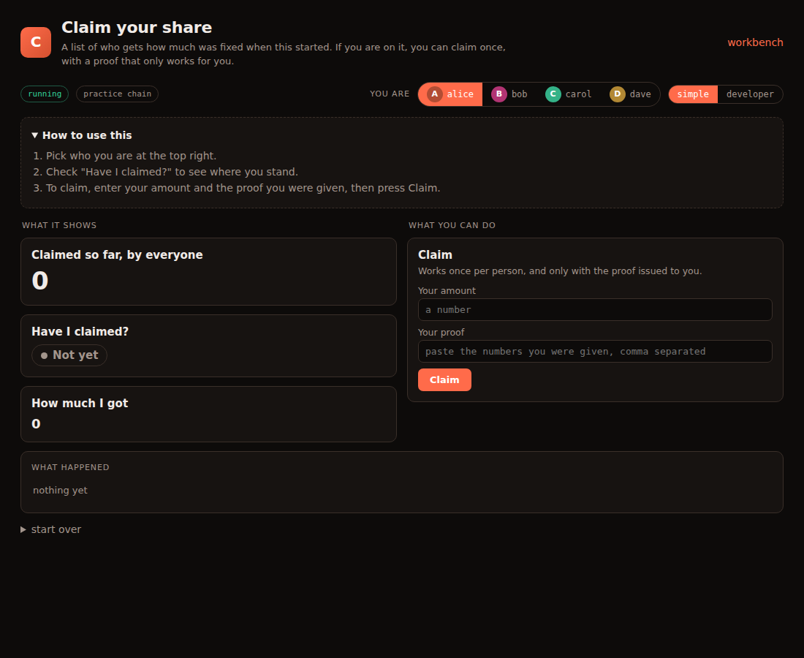

# Simple apps: hiding inputs and outputs

Every contract's page (`/zkworld/<name>/`) has two views:

| | **Simple** (default) | **Developer** |
|---|---|---|
| titles | `Change the number` | `set (value: felt252)` |
| people | avatars + names, a picker for "who" | raw `0x…` addresses |
| outputs | big numbers, charts, Yes/No badges | raw decoded values |
| results | "Done — as bob. The number was set to 77" | `sent as bob · tx 0x41…` + JSON |
| history | sentences | event / fields / block table |
| hidden things | gone | everything shown |

Simple works with **no setup**: it turns `total_claimed` into "Total
claimed", fills any address box with *you*, shows `bool` as Yes/No, and so
on. To go further, put an **`app.json`** next to the contract's `Scarb.toml`:

```
src/mods/<name>/
├── Scarb.toml
├── src/lib.cairo
└── app.json      ← this file
```

Save it and reload the page. No build, no restart. A broken `app.json` is
ignored, and the error is shown in Developer view.



## A complete example

This is `src/mods/airdrop/app.json`, which produced the screenshot above:

```json
{
  "title": "Claim your share",
  "intro": "A list of who gets how much was fixed when this started. If you are on it, you can claim once, with a proof that only works for you.",
  "steps": ["Pick who you are at the top right.",
            "Check \"Have I claimed?\" to see where you stand.",
            "To claim, enter your amount and the proof you were given, then press Claim."],
  "fns": {
    "total_claimed": { "label": "Claimed so far, by everyone", "show": "big" },
    "is_claimed":    { "label": "Have I claimed?", "yes": "Claimed", "no": "Not yet",
                       "inputs": { "who": { "hide": true } } },
    "claimed_of":    { "label": "How much I got", "inputs": { "who": { "hide": true } } },
    "claim":         { "label": "Claim", "button": "Claim",
                       "help": "Works once per person, and only with the proof issued to you.",
                       "inputs": { "amount": { "label": "Your amount" },
                                   "proof":  { "label": "Your proof" } } },
    "root":          { "hide": true }
  },
  "constructor": { "help": "Paste the list's root and press Start.",
                   "inputs": { "root": { "label": "List root" } } },
  "events": { "Claimed": { "say": "{who} claimed {amount}" } }
}
```

Three things happened there:

- **`root` is hidden.** It's a hash that means nothing to a user, so it's gone
  from Simple view.
- **The `who` inputs are hidden.** With no `value` given, a hidden address
  means *the person you picked*. "Have I claimed?" just answers, and
  refreshes itself, with no box and no button.
- **The event is a sentence.** `Claimed {who, amount}` reads "bob claimed 500".

## Hiding things

| to hide… | write | what happens in Simple |
|----------|-------|------------------------|
| a whole function | `"fns": {"root": {"hide": true}}` | card is gone |
| an input, sent as *you* | `"inputs": {"who": {"hide": true}}` | box is gone; address inputs send the current person |
| an input, sent as a fixed value | `"inputs": {"fee": {"value": "0"}}` | box is gone; always sends `0` |
| an input, prefilled but editable | `"inputs": {"amount": {"default": "10"}}` | box shown with `10` in it |
| an output | `"fns": {"get_raw": {"show": "hide"}}` | card is gone (same as `hide: true`) |
| an event | `"events": {"Debug": {"hide": true}}` | not in "what happened" or in results |

Rules worth knowing:

- Hiding is a **view** choice. Developer view always shows everything, and
  the contract itself is unchanged. Don't use it as security: anyone can
  still call a hidden function.
- `"value": "me"` or `"default": "me"` means the current person.
- A *read* whose inputs are all hidden reads itself: no box, no button, and it
  refreshes every 5 s like the zero-input reads.

## Visuals for outputs

Set `"show"` on a function in `fns`. If you leave it out, it's picked from the
output type:

| `show` | looks like | auto-picked for |
|--------|-----------|-----------------|
| `big` | one large number or word | number/text reads with no inputs |
| `number` | a smaller number, with thousands separators | number reads with inputs |
| `chart` | big number + a line of its past values, hover for each one | never; opt in |
| `meter` | big number + a bar filled up to `max` | never; opt in |
| `yesno` | a green **Yes** / grey **No** badge (`yes`/`no` rename them) | `bool` |
| `address` | avatar + name ("bob (you)") | `ContractAddress` |
| `text` | the text inside a `'short string'` felt | `felt252`, `ByteArray` with inputs |
| `list` | a row of chips (names for addresses) | `Span<…>`, `Array<…>` |
| `raw` | the plain decoded value | anything else (structs, tuples) |
| `hide` | nothing | never |

Extra keys that go with them:

| key | on | effect |
|-----|----|--------|
| `unit` | `big`, `number`, `meter`, `chart` | small label after the number: `"unit": "votes"` |
| `max` | `meter` | the full-bar value, in display units: `"max": 100` |
| `decimals` | a fn, an input, or an event | shows `1500000000000000000` as `1.5`, and turns a typed `1.5` back into the raw amount when sending. Tokens are usually `18` |

```json
"fns": {
  "get":        { "label": "Votes so far", "show": "chart", "unit": "votes" },
  "progress":   { "label": "Funded",       "show": "meter", "max": 100, "unit": "%" },
  "balance_of": { "label": "My balance",   "show": "big", "decimals": 18,
                  "inputs": { "account": { "hide": true } } }
}
```

The chart is drawn in your browser from values the page has seen, so it starts
when you first open the page and is kept per deployment. Starting a fresh
copy starts a fresh chart. A contract that needs real history (prices, a
leaderboard) should get its own page; see *Going further*.

## Words everywhere

Top level:

| key | effect |
|-----|--------|
| `title` | page title (Simple only; Developer shows the contract name) |
| `intro` | the line under the title |
| `steps` | the numbered "How to use this" list. It's open on the first visit and folded after |
| `mode` | `"developer"` to open in Developer view by default. A visitor's own choice still wins |
| `fns` | per function, see below |
| `constructor` | `help` + `inputs` for the **Start** form |
| `events` | per event: `say`, `decimals`, `hide` |

Per function (`fns.<name>`):

| key | effect |
|-----|--------|
| `label` | card title. Default: the name, humanised (`claimed_of` → "Claimed of") |
| `help` | one grey line under the title |
| `button` | button text. Default: "Check" for reads, the humanised name for writes |
| `hide` | drop the card |
| `show`, `unit`, `max`, `decimals`, `yes`, `no` | see *Visuals* |
| `inputs.<arg>` | `label`, `help`, `placeholder`, `default`, `value`, `hide`, `decimals` |

**Order:** cards appear in the order you list them under `fns`. Functions you
don't list come after.

**Event sentences:** `say` is a template. `{field}` is replaced with that
field, with addresses as names, numbers grouped, and `decimals` applied. The
zero address reads as "nobody", so a mint reads `nobody sent 1,000 to alice`.

## Starters come with one

`m zkworld/new template=…` copies a ready `app.json` for `counter`, `token`,
`commit_reveal` and `merkle_allowlist` (`src/templates/cairo/<id>/app.json`).
`vibe` knows the format, so you can just ask:

```sh
m zkworld.tips/vibe prompt="update app.json: hide transfer_from, show my balance as a big number with 18 decimals, and say 'X tipped Y N' for Transfer"
```

## Going further

`app.json` covers labels, hiding and the stock visuals. For anything else
(your own layout, real charts, a game board), ship
`src/mods/<name>/app/index.html`. It replaces the default page for that
contract only. Copy `src/templates/cairo/app.html` as a start; it talks to the same
four calls: `_api/app`, `_api/call`, `_api/deploy` and `_api/events`.
